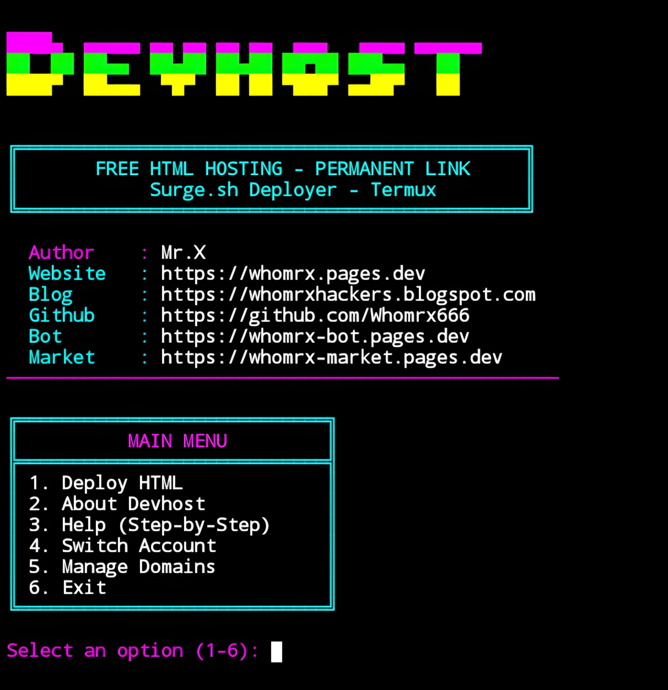

# Devhost


<p align="center">
  <strong>Instant HTML Hosting via Surge.sh – Cyberpunk Neon Edition</strong><br>
  <em>"Deploy with style. Host forever free." – Mr.X</em>
</p>

## Introduction
Devhost is a Termux-based tool that lets you deploy static HTML websites instantly and for free using **Surge.sh**. With a single command, your local HTML files get a permanent public URL with a **.surge.sh** subdomain—no complicated configurations, no GitHub tokens, just pure simplicity. Devhost also includes a domain management system to keep track of all your deployments, deactivate or delete them, and switch between Surge accounts. The sleek cyberpunk neon interface runs smoothly on **Termux (Android)**, Linux, Windows, and Kali Linux—**no root required**.

## Installation
```bash
$ pkg update -y && pkg upgrade -y
$ pkg install git nodejs python -y
$ pip install colorama
$ git clone https://github.com/Whomrx666/Devhost.git
$ cd Devhost
$ python3 install.py
```

## Run manually
```bash
$ python3 Devhost.py
```

## Features
- **100% Free Hosting** – Deploy static HTML on Surge.sh at no cost.
- **Permanent Link** – Your **.surge.sh** URL never expires.
- **No API Token Required** – Just an email & password (one-time login).
- **Custom Subdomain** – Choose your own prefix (e.g., `mywebsite.surge.sh`).
- **Smart Path Scanner** – Automatically finds HTML files on your device.
- **Domain Management** – List, deactivate, activate, and permanently delete domains.
- **Switch Account** – Easily change Surge email without losing settings.
- **Auto-install Surge** – Devhost can install the Surge CLI if missing.
- **Cyberpunk Neon UI** – Neon colors, loading animations, and full-width dividers.
- **Termux Optimized** – Works flawlessly on Android without root.

## Menu Options
| #  | Option | Description |
|----|--------|-------------|
| 1  | Deploy HTML | Upload an HTML file/folder and get a permanent link |
| 2  | About Devhost | Display detailed information about the tool |
| 3  | Help (Step-by-Step) | Show usage guide and tips |
| 4  | Switch Account | Log out and use a different Surge email |
| 5  | Manage Domains | View, deactivate, activate, or delete domains |
| 6  | Exit | Quit the program |

## Instructions
1. **Install** the tool using the commands above.
2. **Run** `python3 Devhost.py` after installation.
3. **First-time setup** – If Surge CLI is missing, Devhost will offer to install it. You'll also be prompted to log in to Surge (free account).
4. **Deploy HTML** – Choose option 1, then select your HTML file via manual path or directory scan.
5. **Choose domain** – Accept the random subdomain or enter your own prefix.
6. **Get your permanent link** – After upload, you'll see the public URL.
7. **Manage domains** – Use option 5 to view, deactivate, or delete deployed domains.
8. **Switch accounts** – Use option 4 to log out and use a different Surge email.

## Observation
This tool is intended for **personal and legitimate website hosting purposes only**. Always ensure you have the rights to deploy the content you upload. The author is not responsible for any misuse, loss of data, or violation of Surge.sh's terms of service.

### Original Author
<a href="https://github.com/Whomrx666"></a>

### <<< If you copy, then give me the credits >>>

## CONNECT WITH ME :

[](https://whomrx.pages.dev)
[](https://whomrxhackers.blogspot.com)
[](https://twitter.com/whomrx666)
[](https://wa.me/6285926601133?text=Halo%2C%20Mr.X)
[](https://www.facebook.com/whomrx.666)
[](https://t.me/Whomr_X)
[](mailto:whomrx666@gmail.com)
[](https://www.tiktok.com/@whomr.x)

**If you want to donate, click on the button**
<a href="https://saweria.co/whomrx"></a>

---

<p align="left">
  
</p>